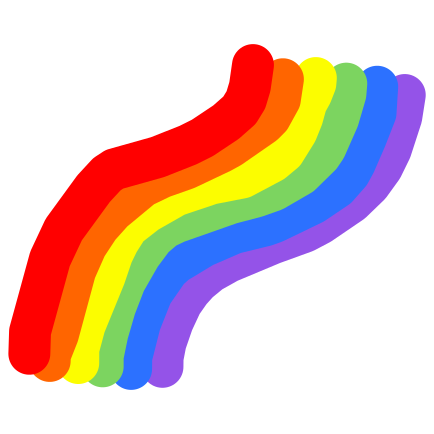

#  Canvas

A simple art canvas. Draw with a pencil, highlighter or eraser, fill areas
with a paint bucket, pick from a color palette, adjust the size of each tool,
add shapes, text, images and sticky notes, draw on the notes, pick several to
move, copy or delete together, stack it all, and undo or redo any of it,
alone or live with others. The canvas fills the space it's
given, with its toolbars floating above it.

**[Try the live demo](https://emmettito.github.io/canvas/)**

## Using it in another project

Install it from GitHub, which builds it as it installs. It works with any
framework, or none, and has no dependencies.

```sh
npm install github:emmettito/canvas
```

Or, to try changes to it before they're pushed, build it and install the copy
next to it:

```sh
npm run build
cd ../my-app
npm install ../canvas
```

Import the stylesheet once and mount the canvas in an element. The canvas fills
the element edge to edge, so give it a size, e.g. the whole window for a
full-screen app.

```ts
import { mountCanvas } from "@emmettito/canvas";
import "@emmettito/canvas/styles.css";

const canvas = mountCanvas(document.getElementById("drawing")!);

// Later, to remove it:
canvas.unmount();
```

### The toolbar

Without a `toolbar`, there's only the canvas. List the controls you want, in
groups, in order. Each button needs an icon, which the library doesn't
provide, so the icons match the rest of your app. Pass any element, e.g. an
`<svg>`. It's copied, shown at 16 by 16 pixels and hidden from screen readers,
since the toolbar names each button itself. Use `currentColor` in it to follow
the toolbar's colors.

```ts
mountCanvas(document.getElementById("drawing")!, {
  toolbar: [
    [
      { action: "undo", icon: undoIcon },
      { action: "redo", icon: redoIcon },
    ],
    [
      { action: "pencil", icon: pencilIcon },
      { action: "eraser", icon: eraserIcon },
      { action: "color" },
    ],
    [{ action: "export", icon: exportIcon }],
  ],
});
```

| Control            | Does                                              |
| ------------------ | ------------------------------------------------- |
| `undo`, `redo`     | Undo or redo the last change                      |
| `clear`            | Remove everything, which can be undone            |
| `new-canvas`       | Start a blank canvas                              |
| `history`          | Open or delete canvases drawn earlier             |
| `export`           | Export as PNG, JPEG or SVG (see below)            |
| `move`             | Move, resize and pick what's placed (see below)   |
| `pencil`, `eraser` | Pick the tool, or its size if already picked      |
| `highlighter`      | The same, drawing see-through (see below)         |
| `bucket`           | Fill areas with the pencil's color (see below)    |
| `text`             | Add text, or pick its size if already picked      |
| `note`             | Add sticky notes                                  |
| `shape`            | Draw shapes, or pick the shape if already picked  |
| `image`            | Insert images from files                          |
| `color`            | Pick the drawing tools' or notes' color (no icon) |
| `dropper`          | Pick a color from the drawing                     |
| `zoom`             | Show the zoom, with a menu to change it (no icon) |
| `timer`            | A timer, showing how long's left (no icon)        |
| `file-menu`        | A File menu of file actions (no icon)             |
| `custom`           | Your own text button, e.g. Settings (no icon)     |

Every change is saved as it's made, so nothing asks before starting a new
canvas or opening another (see [Saving](#saving)).

The toolbar floats at the bottom middle of the canvas. For a second toolbar at
the top left, pass `topToolbar` in the same form, e.g. to keep the file
controls apart from the drawing ones, and for a third at the top right, pass
`topRightToolbar`, e.g. for the zoom, which changes how the canvas is shown
rather than what's drawn. Their menus open downward. Each
control can only be on one toolbar. Ctrl+\ (Cmd+\ on a Mac) hides and shows
them all, to see the whole canvas.

The file actions can go in a File menu instead of being buttons: list any of
`new-canvas`, `history` (shown as "Open"), `rename` and `export` in its
`items`, in order. Menu items are text, so they don't take icons. An action
can be in the menu or a button, not both. `rename` is only in the menu: it asks
for a new name in a small dialog, with Save and Cancel.

For your own buttons, e.g. to open your app's settings beside the File menu,
add `custom` controls with a `label` and an `onClick`. They're text buttons, so
they don't take icons, and there can be any number of them.

```ts
mountCanvas(document.getElementById("drawing")!, {
  topToolbar: [
    [
      {
        action: "file-menu",
        items: ["new-canvas", "history", "rename", "export"],
      },
      { action: "custom", label: "Settings", onClick: openSettings },
    ],
  ],
  topRightToolbar: [[{ action: "zoom" }]],
  toolbar: [
    [
      { action: "pencil", icon: pencilIcon },
      { action: "eraser", icon: eraserIcon },
    ],
  ],
});
```

The canvas's name isn't shown on the canvas. It's used for the exported file's
name, e.g. `Sunset.png`, or `Untitled.png` for an untitled canvas, and in the
history. To show it elsewhere, e.g. in the browser tab, pass
`onNameChange`. It's called with the name as the canvas mounts and whenever the
name changes, and the name is empty for an untitled canvas.

```ts
mountCanvas(document.getElementById("drawing")!, {
  onNameChange: (name) => {
    document.title = `${name || "Untitled"} – My App`;
  },
});
```

Mounting throws if the toolbars can't work as listed, e.g. a misspelled
control, one listed twice (on either toolbar or in the File menu) or a button
without an icon, before anything is
added to the page.

Each tool has a key, shown in its button's tooltip, which picks it while the
canvas is in use and nothing's being typed: V for `move`, P for `pencil`, H
for `highlighter`, E for `eraser`, G for `bucket`, N for `note`, T for
`text`, I for `dropper`, and R, O, L and A for `shape`, with a rectangle,
ellipse, line or arrow. Only tools on a toolbar have one.

Clicking `pencil`, `highlighter` or `eraser` again shows its sizes, each as
the dot it draws, at the size it draws it, with its width in pixels below,
and the one picked ringed, like the color picked. They offer the same sizes:
2, 5, 10, 20 and 40 pixels wide. [ and ] pick the next size down or up, like
Photoshop's. A size is on screen, not on the drawing, so a stroke looks the
size picked at any zoom: zoomed in, it's finer on the drawing, for detail.

Strokes curve smoothly through the points the pointer passed, rather than
turning sharply at each. Drawn with a pen, e.g. an Apple Pencil or a
graphics tablet's, a stroke is wider where the pen pressed harder: from a
quarter of the size picked, pressing lightly, to nearly twice it, pressing
hard. A mouse or a finger draws at the size picked throughout.

The highlighter draws in a color of its own, yellow to start with, which
`color` picks while it's picked. Its strokes are see-through, so what's under
them shows through, and a stroke isn't any darker where it crosses itself.
Like the pencil's, they're stacked with everything else, so one drawn over
text tints it, and one drawn under a note is hidden by it.

### Filling

With `bucket` picked, clicking the canvas fills the area around the click, in
the pencil's color: everything there that looks the same color, up to the
lines around it, as the drawing's drawn. Fills are kept as outlines,
not pixels, so they stay sharp at any zoom and export to SVG as shapes.

- Fills are below every stroke and item, so the lines around one are always
  drawn over its edge. It reaches a little under them, so no gap shows at
  their soft edges. A fill over a fill is above it.
- Only areas closed in by lines are filled, so a stray click can't fill
  everything. Clicking one that isn't, which goes past the canvas's edges
  around everything, or a note's edges, does nothing, and a message at the
  bottom of the canvas says so for a moment. It never changes the
  background.
- On a note, it fills the area inside lines drawn on the note, below its text
  and strokes, and moves and resizes with the note like its strokes.
- The eraser erases fills made before it, like strokes. Clicking an image
  does nothing.
- Inside a rectangle or ellipse, it fills the shape instead (see
  [Shapes](#shapes)), which can be undone like any change.

The area is found in what the canvas shows, and a little more on each side,
so zoom out to fill something bigger than the window. A gap in a line lets
the fill through, like any paint bucket's.

### Shapes, text, images and sticky notes

Like strokes, these are saved with the canvas, can be undone and cleared, and
are included in exports. Strokes and what's placed are stacked in one order,
each new one on top, so a stroke drawn after a note is drawn over it, and one
drawn before is hidden under it. The eraser only erases strokes, never what's
placed, and the pencil and eraser draw over items rather than moving them.

With `move` picked:

- Drag one to move it. Dragging anywhere else pans.
- Drag its edges to resize it. The pointer turns into a resize arrow over
  each side and corner, so there are no handles to see. The side or corner
  across from the one dragged stays where it is.
- Click it to pick it, then Delete or Backspace to delete it. Pressing Tab
  reaches it too, with any tool.
- Shift-click others to pick them too, or Shift-click a picked one to leave
  it out. Shift-drag anywhere else for a box that picks everything it
  touches, as well as what's picked already. Ctrl+A (Cmd on a Mac) picks
  everything, even with another tool, which picks `move`. Clicking anywhere
  else, or Escape, picks nothing.
- With several picked, dragging any of them moves them all, and Delete
  deletes them all. Either is one change, which one undo puts back.
- Double-click text or a note, or press Enter on it, to type in it.

Ctrl+C copies what's picked, and Ctrl+X cuts it. Ctrl+V pastes it, on this
canvas or another, even in another tab, a little further down and right each
time it's pasted, so the copies don't hide each other. Ctrl+D copies what's
picked straight away, in the same way. What's pasted is picked, with `move`,
ready to move. Strokes can't be picked, so they're left where they are.

With `note` or `text` picked, notes or text can be moved and resized the same
way, and clicking one types in it. Whichever tool is picked, right-click an
item, or press and hold one on a touch screen with `move`, for a menu to bring
it to the front, send it to the back, or delete it. A note's menu also has
its colors, to change it to, with its own marked, which can be undone like
any change. Right-clicking text being typed opens the same menu, rather than
the browser's.

**Shapes**: with `shape` picked, dragging on the canvas draws a rectangle,
ellipse, line or arrow between where the drag started and the pointer, in the
pencil's color, as wide as the pencil's size. Clicking `shape` again picks
which, as do their keys. Hold Shift for a square or circle, or a line at an
eighth of a turn. A shape is only pressed where it shows: along its line or
outline, which is easy to press even when it's thin, or anywhere inside one
filled with `bucket`. Its empty middle lets presses through, to what's under
it. A rectangle or ellipse resizes from just outside its outline, and a line
or arrow from its ends, which swing round each other. Shapes are SVG, so they
stay sharp at any zoom, and export to SVG as paths.

**Text**: with `text` picked, clicking the canvas starts text there, in the
pencil's color, at the size picked by clicking `text` again. Until it's typed
in, it shows "Text", and is wide enough to click. Text is as wide
as its longest line, with Enter for a new line, until a side is dragged, which
sets the width it wraps at. Resizing only resizes the box, never the text, and
the box can't be made shorter than its text.

**Sticky notes**: with `note` picked, clicking the canvas adds a note there.
While `note` is picked, `color` picks the color of new notes, which are a light
shade of it, so their text stays readable. Yellow is the default. Text that
doesn't fit in a note is hidden, and left out of the export.

A note being moved snaps to the notes on screen near it: its edges or middle
line up with theirs, or it sits a small gap beside one it's level with, and
lines show what it lined up with. Hold Alt (Option on a Mac) while moving it to
place it exactly.

A stroke started on a note, with the pencil or eraser, is drawn on it, over
its text, unless an image is above the note there. It only shows inside the
note and moves with it. Resizing the note doesn't stretch its strokes: they
stay where they are, and any outside the note are hidden until it's made big
enough again. The eraser started on a note only erases the note's strokes,
and one started off it only erases the drawing's.

**Typing**: with `move` picked, double-clicking text or a note, or pressing
Enter on one, types in it. With `note` or `text` picked, clicking one does.
Clicking away or pressing Escape finishes, and one left empty is removed. The
text is plain unless the page adds a text editor that formats it (see
[Formatting text](#formatting-text)).

**Images**: `image` opens a file picker. Images can also be pasted, where the
pointer is over the canvas, or dropped onto it, where they're dropped. Each is
scaled down to fit the canvas if it's bigger, and resizes from its corners,
keeping its shape. Once they're in, `move` is picked, if a toolbar has it,
with the last image picked, ready to move, resize or delete. Images are kept byte for byte, so nothing is lost, and SVG
exports include them unchanged.

### Colors

`color` picks the pencil's color, which text uses too, or new notes' while
`note` is picked. Besides the palette, any color can be picked with the
browser's color picker, or typed as any solid CSS color, e.g. `#ff8800`,
`orange` or `hsl(30 100% 50%)`, which is kept as hex. The box shows the
color picked now, selected to type over. One that's the
palette's, e.g. `red`, is the palette's. Custom colors are offered again under
Recent. While text or a note is being typed in, `color` colors the text too,
and typing carries on. Where the browser can, e.g. Chrome and Edge,
"Pick from screen" picks a color from anywhere on screen.

`dropper` picks a color from the drawing, wherever it's clicked, including
images, notes and the background, then goes back to the tool before it. A
color from the palette is kept as the palette's. With a mouse, a magnifier
follows the pointer, showing the pixels around it and the color it would
pick.

Colors are kept as they're picked, whatever the theme.

### Backgrounds

Each canvas has its own background, which exports keep. It's undone like any
other change, and stays the same whatever the page's theme. The library has no
control for it, so your page shows its own picker, styled to match: pass
`onBackgroundChange` to be told the open canvas's background as the canvas
mounts and whenever it changes, e.g. when it's undone or another canvas opens,
and call `setBackground` on the mounted canvas to change it. It takes any solid
CSS color, and throws for one that isn't, e.g. `transparent`.

```ts
const canvas = mountCanvas(document.getElementById("drawing")!, {
  onBackgroundChange: (color) => {
    picker.value = color;
  },
});
picker.addEventListener("change", () => canvas.setBackground(picker.value));
```

A new canvas starts with `--canvas-color-canvas`, so a dark theme can start new
canvases dark. When a canvas opens or its background
changes, a black pencil turns white on a dark background, and white black on a
light one, so it shows.

### Signing notes

Pass `author`, the `firstName` and `lastName` someone set, and each new note is
signed with it in small, quieter type along its bottom, inside its padding, so
its text has a line less room. A byline shows first names, unless two people
who signed notes on the canvas share one: then it's "Ada L." and "Ada K.", or
the whole name if those match too. Changing a note's text, or drawing or
filling on it, adds the name after the names already there, e.g. "Ada, Bo",
unless it's there already. Notes saved with a whole name are split at its
first space. Moving or resizing a note, or changing its color, doesn't. Exports draw the byline the same way, cut short with an
ellipsis if it's too long. PNG and SVG exports also keep the whole name as their
author: an `Author` iTXt chunk in a PNG, and Dublin Core's `dc:creator` in an
SVG's metadata. JPEGs don't. Call `setAuthor` on the mounted canvas when the
name changes. Notes already signed keep the names they were signed with, and
without one, nothing's signed. Pass `showAuthors: false`, or call
`setShowAuthors(false)`, to hide every note's byline, on the canvas and in
exports, and give its text that line back. Notes stay signed, so showing
bylines again brings their names back.

```ts
const canvas = mountCanvas(document.getElementById("drawing")!, {
  author: { firstName: "Ada", lastName: "Lovelace" },
});
canvas.setAuthor({ firstName: first.value, lastName: last.value });
```

### Formatting text

To format notes' and text's text, install [ProseMirror](https://prosemirror.net)
and pass the canvas's ProseMirror editor as `textEditor`. It's a separate
import, so pages that don't use it don't need ProseMirror.

```sh
npm install prosemirror-commands prosemirror-history prosemirror-keymap \
  prosemirror-model prosemirror-state prosemirror-view
```

```ts
import { mountCanvas } from "@emmettito/canvas";
import { proseMirrorEditor } from "@emmettito/canvas/prosemirror";

mountCanvas(document.getElementById("drawing")!, {
  textEditor: proseMirrorEditor,
});
```

While typing, a bar above the text formats what's selected, or what's typed
next: its font, size, bold, italic, underline, line through, color and
alignment. Ctrl+B, Ctrl+I and Ctrl+U (Cmd on a Mac) and Ctrl+Shift+X for a
line through work too, and Ctrl+Z undoes typing until it's finished.
Formatting is kept in exports, and copies between notes and text. Without the
editor, formatted text shows as plain text, and keeps its formatting unless
it's changed.

`textEditor` takes any `TextEditorFactory`, so another editor can be used
instead. It makes a `TextEditor` for each note and text box, which shows its
`RichText` and is typed in. One with `formatting` gets the format bar.

### Zooming and panning

The canvas shows part of a drawing that goes on in every direction. Like
Figma:

- Scroll, or swipe with two fingers on a trackpad, to pan. Hold Shift to
  scroll a mouse wheel sideways.
- Hold Space and drag, or drag with the middle button, to pan.
- Ctrl+scroll (Cmd on a Mac) or pinch a trackpad to zoom around the pointer.
- On a touch screen, pinch and drag with two fingers. One finger draws, or
  pans with `move` picked.
- Ctrl+= and Ctrl+- zoom in and out, Ctrl+0 or Shift+0 goes back to 100%, and
  Shift+1 fits the whole drawing in the window. They work while the pointer is
  over the canvas, or nothing else on the page has focus.

The zoom is from 10% to 1000%, and `zoom` on a toolbar shows it, with a menu
of the same actions. Each canvas reopens where it was left.

### Timer

`timer` on a toolbar sets a timer: 1, 3, 5, 10, 15 or 30 minutes, or any
number up to a day, with a sound to play as it goes off: Chime, Bell,
Marimba, Alarm, or None. Picking a sound plays it, to hear it first. The
sounds are made as they play, with the Web Audio API, so there are no files
to load. While it's going, the button shows how long's left, and opening it
offers a minute more or stopping it. Once it's done, its sound plays and
"Time's up" shows. A new timer starts with the last one's length and sound.
While drawing together, it goes off for everyone: whoever starts it picks the
sound, anyone can add time or stop it, someone joining sees how long's left,
and everyone else is told who started it. Browsers only play sound on a page
that's been clicked or typed in, so a page nobody's touched shows "Time's up"
without it.

Shift+R, or "Show rulers" in the `zoom` menu, shows rulers along the top and
left edges, so it's clear where on the drawing the canvas is. They're in
drawing units, with 0 where the drawing started, and mark the pointer's
position on each, or the middle of the view, in gray, while the pointer's off
the canvas. The corner where they meet goes back to the origin, at the same
zoom. The toolbars at the top move clear of them, and whether they're shown
is kept with the other settings.

### Exporting

`export` opens a small dialog to choose the file:

- **Format**: PNG, JPEG or SVG. SVG keeps the strokes as shapes, so it stays
  sharp at any size and can be edited in other tools.
- **Size**: 1×, 2× (the default) or 4× the part of the drawing the canvas
  shows, at 100%, which the dialog shows in pixels. Zoom out to export more of
  the drawing. The drawing is drawn again at that size, rather than copied
  from the screen, so the file doesn't depend on the screen's resolution. A
  PNG or JPEG too big for every browser to make (over 4096 × 4096 pixels) isn't
  offered.
- **Transparent background**: leaves out the canvas color, for PNG and SVG.
  JPEG has no transparency.

The dialog starts from the choices last exported with, which are kept with the
other settings under `storageKey`.

### Drawing together

People can draw on one canvas together, live, through a server you run.
Everyone's changes show as they're made, with each person's pointer and name
in their own color, and a row of who's there, with their photos, at the start
of the top right toolbar. Each pointer looks like the tool it's pointing with:
a ring as big as the pencil, highlighter or eraser draws, an I-beam for text,
a crosshair for notes, shapes and the paint bucket, the dropper, or an arrow
for the move tool. Its name is the first name, with more of it for two people
here who share one, as bylines do, and the row shows whole names. It's added while anyone's there, even without
`topRightToolbar`, and hidden with the toolbars. What they're in the middle of shows too: a stroke as it's drawn, an
item as it's moved or resized, outlined in their color, and a note or text
as it's typed, even a new one, before it's added. Undo only
undoes your own changes, leaving everyone else's, even ones made since. Each
person's canvas is kept like any other, so it's there to open again on its
own.

Clicking someone in the row follows them: your canvas shows what theirs
does, as big as fits, edged in their color, with "Following Ada" and a Stop
button at the top. Moving around yourself, by scrolling, dragging or
zooming, stops following too. Follow me, beside the row, has everyone else
follow you. Whoever's followed sees "Bo is following you" for each person,
with a Release button that lets them go. Following someone who follows you,
even through others, would go round in a circle, so the server turns it
away.

The library doesn't send anything itself. On the page, call `collaborate` on
the mounted canvas with a `connection` that carries its messages, e.g. over a
WebSocket, and the `room` to join. The canvas with the room's id opens, or a
new one with it, so the room's id can be the canvas's own: `canvasId` is the
open one's. The room starts from the drawing of whoever joins it first. It
returns a function that leaves the room, and opening another canvas leaves it
too. `onLeave` is called either way.

Pass `avatar`, an image's data URL or an https address, and everyone else
sees that photo instead of an initial. Call `setAvatar` when it changes, and
`setAuthor` for the name, and they're told. Keep it small, e.g. 128 pixels
square, since it's sent to everyone who joins: the server turns away one
longer than 200,000 characters.

```ts
const socket = new WebSocket("wss://example.com/draw");
const leave = canvas.collaborate(
  {
    send: (message) => socket.send(JSON.stringify(message)),
    listen: (listener) => {
      const onMessage = (event: MessageEvent) =>
        listener(JSON.parse(event.data));
      socket.addEventListener("message", onMessage);
      return () => socket.removeEventListener("message", onMessage);
    },
  },
  { room: canvas.canvasId, onLeave: () => socket.close() }
);
```

On the server, `CollaborationServer` from
`@emmettito/canvas/collaboration-server` runs the rooms. It has no
dependencies and doesn't touch the DOM, so it runs in Node. Connect each
canvas, pass on what it sends, and close it when it goes. A room lasts until
everyone's left, and keeps everything in memory, so it's for small groups.
What someone's in the middle of is passed on but never kept.

```ts
import { CollaborationServer } from "@emmettito/canvas/collaboration-server";
import { WebSocketServer } from "ws";

const rooms = new CollaborationServer();
new WebSocketServer({ port: 8080 }).on("connection", (socket) => {
  const connection = rooms.connect((message) =>
    socket.send(JSON.stringify(message))
  );
  socket.on("message", (data) => connection.receive(JSON.parse(String(data))));
  socket.on("close", () => connection.close());
});
```

Changes to different parts of the same item are both kept, e.g. one person
moving a note while another types in it. The same part changed by two
people at once, e.g. both typing in a note, keeps whichever reached the
server last. Text being typed stays as it is until typing stops, whatever
anyone else does.

### Saving

Every change is saved as it's made, and the last canvas open reopens on the
next mount. A blank canvas only joins History once it's changed, e.g. by a
stroke or a rename. Editing a canvas moves it to the top of History, and
deleting the open one opens the next most recent. Without `history`, there's
only ever one canvas, and starting a new one replaces it.

To keep canvases and toolbar settings across page loads, pass a `storageKey`.
They're saved in local storage under keys starting with it, so give each
canvas on a site its own. Images' files are too big for local storage, so
they're saved in IndexedDB under the same key, and removed along with their
canvas. Without a key, everything only lasts until the page closes. If a
change can't be saved, e.g. because storage is full, the canvas says so at its
top right. Undo history isn't saved, and opening a canvas starts its
undo history afresh.

```ts
mountCanvas(document.getElementById("drawing")!, { storageKey: "drawing" });
```

The stylesheet only styles the canvas and its toolbar, so it doesn't affect the
rest of the page, and the page's element styles (e.g. `button {}`) don't affect
the toolbar. Toolbar text uses the page's font.

To change the colors, set these variables on `.canvas-root` in a rule that
isn't in a CSS layer:

```css
.canvas-root {
  --canvas-color-canvas: #fdf6e3;
}
```

| Variable                        | Used for                                 |
| ------------------------------- | ---------------------------------------- |
| `--canvas-color-canvas`         | New canvases' background                 |
| `--canvas-color-cursor`         | Tool size preview under the pointer      |
| `--canvas-color-surface`        | Toolbar and menu background              |
| `--canvas-color-border`         | Borders and dividers                     |
| `--canvas-color-text`           | Text, and icons when chosen              |
| `--canvas-color-text-muted`     | Icons, dates and placeholders            |
| `--canvas-color-hover`          | Background of a control under the mouse  |
| `--canvas-color-selected`       | Background of the chosen tool and color  |
| `--canvas-color-accent`         | Focus rings and the size picked          |
| `--canvas-color-danger`         | Deleting, and changes that weren't saved |
| `--canvas-color-tooltip`        | Tooltip background                       |
| `--canvas-color-tooltip-text`   | Tooltip text                             |
| `--canvas-color-swatch-outline` | Outline around each color swatch         |
| `--canvas-color-note-text`      | Text on sticky notes                     |
| `--canvas-shadow`               | Shadow under toolbars, menus and notes   |

The drawing colors are `--canvas-color-` followed by `black`, `gray`, `white`,
`cyan`, `blue`, `purple`, `magenta`, `pink`, `red`, `orange`, `amber`, `gold`,
`yellow`, `lime` and `green`. Changing one changes its swatch and new strokes in
that color.

## Development

Requires Node 24 (Vite 8 needs at least 20.19 or 22.12).

```sh
npm install
npm run dev
```

| Script                 | Description                              |
| ---------------------- | ---------------------------------------- |
| `npm run dev`          | Start the dev server                     |
| `npm run build`        | Type-check and build the library         |
| `npm run build:demo`   | Type-check and build the demo page       |
| `npm run build:e2e`    | Build the demo and test pages for CI     |
| `npm run preview`      | Serve the demo page build                |
| `npm run lint`         | Lint with oxlint, failing on warnings    |
| `npm run typecheck`    | Type-check without building              |
| `npm run format`       | Format with oxfmt                        |
| `npm run format:check` | Check formatting without changing files  |
| `npm run test`         | Run the unit tests with Vitest           |
| `npm run test:watch`   | Run the unit tests in watch mode         |
| `npm run test:e2e`     | Run the Playwright tests in all browsers |
| `npm run icons <svg>`  | Make the demo's favicons from an SVG     |

The Playwright tests run in Chromium, Firefox, and WebKit. Install the browsers
once before the first run:

```sh
npx playwright install
```

The demo page only draws, so most tests use a test page with every control
instead, `e2e/fixtures/full.html`: it saves under `storageKey`, has the File
menu and the timer, and keeps the mounted canvas as `window.canvas`, for the
tests to call what a page would from its own controls, e.g. `setAuthor`. It
draws together in the room in its address's `room`, through a WebSocket at
`/collaborate` that the dev server and `vite preview` run with
`CollaborationServer` (see `server/collaboration-socket.ts`).

## Demo page

`npm run dev` serves the demo page, where the canvas fills the window, with
the drawing tools at the bottom and the zoom at the top right, and formatted
text. It's only for drawing: there's no File menu, timer, settings or drawing
together, and nothing's saved, so a refresh starts again.

The full app built on the library, with saving, naming canvases, profiles,
themes, the timer and drawing together, is
[canvas-app](https://github.com/emmettito/canvas-app).

The demo's toolbar icons are [Phosphor](https://phosphoricons.com)'s regular
weight, under the MIT license, which the demo page ships in
`public/licenses/phosphor-icons.txt`. They're a development dependency only.

The favicons are a drawing made on the canvas. To make new ones, export a
drawing as SVG and run `npm run icons path/to/drawing.svg`. It crops the
strokes to a square, keeps the file small, and makes every size browsers and
devices ask for, with a web app manifest, in `public/`.

Every push to `main` builds the demo page and publishes it to GitHub Pages (see
`.github/workflows/deploy-demo.yml`). For that to work, set **Settings → Pages →
Source** to **GitHub Actions** in the repository.

## License

[MIT](LICENSE)
